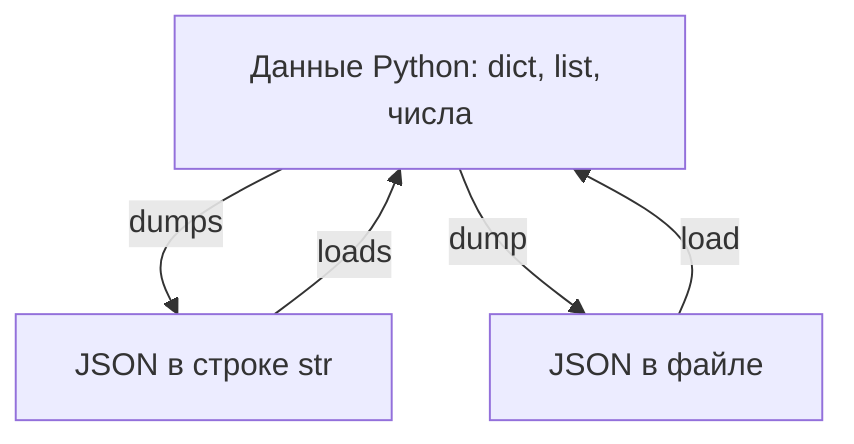

# Sanya Learn OOP

Учебный репозиторий для изучения Python: объектно-ориентированного программирования, структур данных, работы с файлами и рабочего процесса в GitHub.

## Как пользоваться памяткой

- Перед домашней работой повтори нужный раздел.
- Не заучивай определения отдельно от кода: придумай собственный короткий пример.
- Выполняй каждую практическую issue в отдельной ветке.
- Не добавляй новую функциональность прямо в `main`.

## Учебные модули и домашние работы

Префикс `learn` зарезервирован для модулей занятий преподавателя. При повторении и определении нового материала учитываются **все Python-файлы, имя которых начинается с `learn`**, в том числе во вложенных папках.

| Модуль | Материал |
|---|---|
| `learn_oop.py` | Классы, методы, принципы ООП, исключения, `Protocol` и адаптер |
| `learn_structs.py` | Отладка, классы данных, перечисления и `match` |
| `learn_mutability_and_references.py` | Изменяемость, ссылки и копирование коллекций |
| `learn_file_system.py` | Текстовые файлы, `with`, CSV, JSON, сериализация и построение путей через `Path` |
| `tools.py` | Команды инструментов и примеры для проверки качества кода |

Файл домашней работы называй по его назначению, например `product.py` или `order_import.py`. **Не начинай имя своего файла с `learn`**: иначе решение будет смешано с материалом занятия. Имя ветки и имя файла — разные вещи.

## Класс, объект и `self`

**Класс** — описание данных и поведения объектов определённого типа.  
**Объект, или экземпляр класса** — конкретное значение, созданное на основе класса.

У класса обычно есть:

- **атрибуты** — данные объекта;
- **методы** — операции, которые объект умеет выполнять.

`self` — ссылка на конкретный экземпляр, для которого вызван метод. При вызове связанного метода Python передаёт этот объект первым аргументом автоматически:

```python
dog.sit()
# По смыслу соответствует:
Dog.sit(dog)
```

Имя `self` является соглашением, а не ключевым словом, но использовать другое имя не следует.

## Атрибуты класса и экземпляра

**Атрибут класса** принадлежит классу и по умолчанию является общим для его экземпляров.

**Атрибут экземпляра** хранится в конкретном объекте. Обычно он создаётся через `self` внутри `__init__`.

```python
class Student:
    university = "МАИ"  # атрибут класса

    def __init__(self, name: str) -> None:
        self.name = name  # атрибут экземпляра
```

Если присвоить значение через экземпляр, например `student.university = "МГУ"`, у объекта появится собственный атрибут, который скроет одноимённый атрибут класса.

## Виды методов

### Метод экземпляра

Принимает `self` и работает с состоянием конкретного объекта.

### Метод класса

Помечается `@classmethod`, принимает `cls` и работает с классом. Частый сценарий — альтернативный конструктор.

```python
@classmethod
def from_string(cls, value: str):
    ...
    return cls(...)
```

Использование `cls(...)`, а не жёстко записанного имени класса, сохраняет корректное поведение при наследовании.

### Статический метод

Помечается `@staticmethod` и не получает автоматически ни `self`, ни `cls`. Подходит для вспомогательной операции, логически связанной с классом, но не использующей его состояние.

Если функция не связана с ответственностью класса, лучше оставить её обычной функцией модуля.

## Специальные методы

Специальные, или dunder-методы, позволяют объекту участвовать в стандартных операциях Python:

- `__init__` — инициализация экземпляра;
- `__str__` — удобное строковое представление;
- `__eq__` — сравнение через `==`;
- `__add__` — поведение оператора `+`;
- `__mul__` — поведение оператора `*`.

Реализация операторов должна соответствовать понятному смыслу типа. Не стоит перегружать оператор только потому, что это технически возможно.

## Наследование и полиморфизм

Наследование описывает отношение **«является»**: `Cat` является разновидностью `Animal`.

Подкласс получает доступ к поведению базового класса и может переопределить его методы. Возможность вызвать один и тот же метод у объектов разных классов и получить подходящее каждому объекту поведение — проявление полиморфизма.

`super()` передаёт вызов следующему классу в MRO. Это особенно важно при множественном наследовании: `super()` не обязательно означает «вызвать моего единственного родителя».

## Проверка типов

- `isinstance(obj, Class)` проверяет тип объекта с учётом наследования;
- `issubclass(Child, Parent)` проверяет отношение между классами;
- `type(obj) is Class` выполняет строгое сравнение конкретного типа без учёта наследования;
- `is` сравнивает идентичность объектов, а не их типы и не равенство значений.

В прикладном коде обычно предпочтительнее `isinstance()`, потому что он поддерживает полиморфизм.

## Абстрактные классы

Абстрактный базовый класс задаёт общий контракт для подклассов.

```python
from abc import ABC, abstractmethod

class Shape(ABC):
    @abstractmethod
    def area(self) -> float:
        ...
```

Пока в подклассе остаются нереализованные абстрактные методы, создать его экземпляр нельзя. Абстрактный метод может содержать общую реализацию, но всё равно требует явного переопределения в конкретном подклассе.

Абстракция отвечает на вопрос **«что должен уметь объект?»**, а конкретный класс — **«как именно он это делает?»**.

## Множественное наследование и MRO

При множественном наследовании у класса несколько базовых классов. Python ищет атрибуты и методы в порядке **MRO — Method Resolution Order**.

Посмотреть порядок можно так:

```python
print(MyClass.mro())
print(MyClass.__mro__)
```

В ромбовидной иерархии прямые вызовы вида `Parent.__init__(self, ...)` могут повторно инициализировать общий базовый класс или нарушить порядок обработки. Для кооперативного наследования каждый участник цепочки должен согласованно использовать `super()` и совместимые сигнатуры.

Множественное наследование усложняет код. Для небольшой независимой возможности часто подходят mixin-классы; для отношения «содержит» обычно лучше композиция.

## Композиция и агрегация

Обе связи описывают отношение **«содержит»**.

**Композиция** — объект-владелец создаёт и контролирует свою часть. Часть рассматривается как деталь его реализации.

**Агрегация** — готовый независимый объект передаётся владельцу извне и может использоваться отдельно.

Пример: если `Car` сам создаёт `Engine`, модель показывает композицию. Если готовый `Driver` передаётся автомобилю, это агрегация.

В Python фактическое время жизни объекта зависит от существующих ссылок и сборщика мусора, поэтому различие прежде всего выражает ответственность и владение в модели.

## Инкапсуляция и уровни доступа

**Инкапсуляция** объединяет состояние объекта и методы работы с ним, а детали реализации скрывает за понятным публичным интерфейсом. Пользователь класса должен знать, что можно сделать с объектом, но не обязан зависеть от того, как данные хранятся внутри.

В Python уровни доступа выражаются прежде всего соглашениями об именовании:

- `name` — публичный атрибут, предназначенный для обычного использования;
- `_name` — защищённый атрибут: технически доступен снаружи, но считается внутренней частью класса или его подклассов;
- `__name` — приватное имя, для которого Python применяет **name mangling**.

Для атрибута `__login` класса `User` Python создаёт внутреннее имя вида `_User__login`. Это защищает от случайного совпадения имён в подклассах, но не обеспечивает безопасность и не запрещает доступ полностью.

## `property`, getter и setter

`property` позволяет обращаться к методу как к обычному атрибуту. Так класс сохраняет удобный интерфейс и одновременно контролирует чтение и изменение значения.

```python
class User:
    def __init__(self, login: str) -> None:
        self.login = login

    @property
    def login(self) -> str:
        return self._login

    @login.setter
    def login(self, value: str) -> None:
        normalized = value.strip()

        if len(normalized) < 4:
            print("Логин должен содержать не менее четырёх символов")
            return

        self._login = normalized
```

Выражение `self.login = value` вызывает setter, а `self.login` — getter. Внутри них значение обычно хранится под другим именем, например `_login`; иначе обращение к `self.login` из его же setter может привести к бесконечной рекурсии.

Setter вызывается и во время `__init__`, поэтому одна и та же проверка работает как при создании объекта, так и при последующих присваиваниях.

В ранних учебных примерах при неправильном значении setter выводил сообщение и выполнял `return`. При изменении уже созданного корректного объекта это сохраняет прежнее значение. Однако при неправильных данных в `__init__` нужный атрибут может остаться неинициализированным. Теперь, после изучения исключений, неудачную проверку можно явно обозначать через `raise TypeError(...)` или `raise ValueError(...)`, чтобы вызывающий код мог обработать ошибку.

Свойство только с getter и без setter является доступным только для чтения через публичный интерфейс.

## Полиморфизм

**Полиморфизм** позволяет одному и тому же коду работать с объектами разных типов, если они предоставляют ожидаемое поведение. Вызывающая сторона использует общий интерфейс и не обязана знать внутреннее устройство каждого объекта.

Встроенный полиморфизм уже встречается в обычном Python:

```python
print(1 + 2)
print("Hello, " + "world!")

print(len([1, 2, 3]))
print(len("Python"))
```

Оператор `+` и функция `len()` работают с разными типами, но конкретный результат определяется самим объектом.

### Полиморфизм через наследование

Связанные классы могут наследоваться от общего базового класса и по-разному реализовывать один метод:

```python
class Animal:
    def speak(self) -> str:
        return "Неизвестный звук"


class Dog(Animal):
    def speak(self) -> str:
        return "Гав!"


class Cat(Animal):
    def speak(self) -> str:
        return "Мяу!"
```

Код может одинаково вызвать `speak()` у каждого объекта, а нужная реализация выберется в зависимости от фактического типа объекта.

## Утиная типизация

При утиной типизации важен не класс объекта, а наличие необходимого поведения. Объект не обязан наследоваться от общего родителя, если он предоставляет ожидаемые методы.

```python
class EmailSender:
    def send(self) -> str:
        return "Отправлено по электронной почте"


class SmsSender:
    def send(self) -> str:
        return "Отправлено по SMS"


def notify(sender) -> str:
    return sender.send()
```

Функция `notify()` работает с любым объектом, у которого есть подходящий метод `send()`. Добавление нового отправителя не требует дописывать цепочку проверок через `isinstance()`.

Наследование полезно, когда требуется явно зафиксировать общую связь и обязательный контракт. Утиная типизация удобна, когда достаточно совместимого поведения без жёсткой привязки классов друг к другу.

## Положительная и отрицательная бесконечность

Python позволяет создать специальные значения положительной и отрицательной бесконечности:

```python
positive_infinity = float("inf")
negative_infinity = float("-inf")
```

Они ведут себя как числовые значения и удобны, когда нужно задать начальную границу для поиска минимума или максимума. Например, любое обычное число меньше `float("inf")`.

## Разница между `__str__` и `__repr__`

Оба специальных метода возвращают строковое представление объекта, но предназначены для разных задач:

| Метод | Для кого | Основная цель |
|---|---|---|
| `__str__` | Пользователь программы | Понятный и удобный вывод |
| `__repr__` | Разработчик | Подробное и однозначное описание объекта |

```python
class User:
    def __init__(self, name: str, age: int) -> None:
        self.name = name
        self.age = age

    def __str__(self) -> str:
        return f"Пользователь: {self.name}"

    def __repr__(self) -> str:
        return f"User(name={self.name!r}, age={self.age!r})"
```

`print(user)`, `str(user)` и подстановка объекта в f-строку используют `__str__`. Вызов `repr(user)` использует `__repr__`.

Хороший `__repr__` показывает тип объекта и важные атрибуты. Представление, из которого можно воссоздать объект, полезно, но Python не требует этого автоматически.

## Исключения

**Исключение** — объект, сообщающий о ситуации, в которой программа не может нормально продолжить текущую операцию.

Исключения отделяют основную логику от обработки ошибок:

```python
try:
    result = 10 / divisor
except ZeroDivisionError as error:
    print(f"Ошибка деления: {error}")
else:
    print(f"Результат: {result}")
finally:
    print("Попытка вычисления завершена")
```

Назначение блоков:

- `try` содержит код, в котором ожидается исключительная ситуация;
- `except` обрабатывает конкретный тип исключения;
- `else` выполняется только тогда, когда исключение не возникло;
- `finally` выполняется всегда и подходит для обязательного завершения работы или освобождения ресурса.

Следует перехватывать наиболее конкретные исключения. Если нужен общий `except Exception`, он должен находиться после обработчиков конкретных типов, иначе скроет их.

Конструкция `except SomeError as error` сохраняет пойманный объект исключения в переменную и позволяет получить его сообщение.

## Создание исключений через `raise`

`raise` явно прерывает текущую операцию и создаёт исключение:

```python
def validate_age(age: int) -> None:
    if age < 0:
        raise ValueError("Возраст не может быть отрицательным")
```

Используй подходящий встроенный тип:

- `ValueError` — тип значения подходит, но само значение недопустимо;
- `TypeError` — передан объект неподходящего типа;
- `IndexError` — индекс находится за границами последовательности;
- `KeyError` — в отображении отсутствует требуемый ключ.

Не следует заменять исключение только вызовом `print()`, если вызывающий код должен узнать, что операция не выполнена.

## Собственные исключения

Для ошибки предметной области можно создать отдельный класс, унаследованный от `Exception`:

```python
class InvalidPhoneError(Exception):
    """Номер телефона не прошёл проверку."""


def validate_phone(phone: str) -> None:
    if not phone.startswith("+7"):
        raise InvalidPhoneError("Телефон должен начинаться с +7")
```

Собственный тип позволяет вызывающему коду отличить ожидаемую бизнес-ошибку от других проблем программы и обработать именно её.

## Структурная типизация через `Protocol`

`Protocol` описывает, какие методы и свойства должен иметь объект. Наследоваться от протокола явно необязательно: достаточно соответствовать его структуре.

```python
from typing import Protocol


class ReaderProtocol(Protocol):
    def read(self) -> str:
        ...


def process_file(reader: ReaderProtocol) -> str:
    return reader.read()
```

Теперь mypy может проверить, что переданный объект действительно предоставляет метод `read() -> str`. Это делает утиную типизацию явной для разработчика и статического анализатора.

`Protocol` описывает требуемое поведение, но сам по себе не выполняет проверку данных и не заменяет обработку исключений.

## Адаптер

**Адаптер** приводит существующий несовместимый интерфейс к интерфейсу, который ожидает клиентский код.

```python
class LegacyTextReader:
    def read_file(self) -> str:
        return "Данные из старого источника"


class TextReaderAdapter:
    def __init__(self, reader: LegacyTextReader) -> None:
        self.reader = reader

    def read(self) -> str:
        return self.reader.read_file()
```

Клиент вызывает единый метод `read()`, а адаптер перенаправляет вызов к старому методу `read_file()`. Исходный класс при этом менять не требуется.

## Изменяемость, ссылки и идентичность

Переменная связывает имя с объектом. Присваивание `backup = original` не копирует объект: оба имени могут ссылаться на один список.

| Тип | Можно изменить сам объект? |
|---|---|
| `list`, `dict`, `set` | Да |
| `int`, `float`, `bool`, `str`, `tuple` | Нет |

Изменяемость относится к объекту, а не к имени переменной. Переменную можно перепривязать и к другому неизменяемому объекту.

`==` сравнивает значения, а `is` — идентичность: один ли это объект. `id()` возвращает идентификатор объекта, постоянный в течение его жизни; после уничтожения объекта идентификатор может использоваться повторно. Числа из `id()` не нужно запоминать.

### Список: `+` и `+=`

```python
items = ["мышь"]
backup = items
items = items + ["клавиатура"]

print(items)           # ['мышь', 'клавиатура']
print(backup)          # ['мышь']
print(items is backup) # False

items = ["мышь"]
backup = items
items += ["клавиатура"]

print(backup)          # ['мышь', 'клавиатура']
print(items is backup) # True
```

Для списка `+` создаёт новый список, а `+=` расширяет существующий. Поэтому результат изменения через `+=` виден через все ссылки на тот же список. Оператор `+` связан с `__add__`, а `+=` сначала пытается использовать `__iadd__`; поведение определяется типом.

### Строки и кортежи

```python
text = "Python"
previous_text = text
text += "!"

print(previous_text)  # Python
print(text)           # Python!

numbers = (1, 2)
numbers *= 2
print(numbers)        # (1, 2, 1, 2)
```

Исходная строка и исходный кортеж не изменяются: переменная связывается с результатом операции. Само наличие `+=` или `*=` не гарантирует изменение объекта на месте.

Неизменяемость кортежа означает запрет менять его состав. Если внутри находится список, этот вложенный список остаётся изменяемым.

## Поверхностное и глубокое копирование

| Действие | Что получается |
|---|---|
| `backup = original` | Ещё одна ссылка на тот же объект |
| `original.copy()` или `copy.copy(original)` для списка | Новый внешний список, но ссылки на вложенные объекты сохраняются |
| `copy.deepcopy(original)` | Для обычных вложенных коллекций — копия с отдельными вложенными изменяемыми объектами |

```python
import copy

original = [[10, 20], "готово"]
shallow = original.copy()
deep = copy.deepcopy(original)

shallow[0][0] = 99

print(original)  # [[99, 20], 'готово']
print(deep)      # [[10, 20], 'готово']
```

У поверхностной копии внешний список новый, но внутренний список общий с оригиналом. Глубокая копия в этом примере позволяет менять вложенный список независимо от оригинала.

### Повторение вложенных списков

```python
shared_rows = [[0] * 2] * 2
shared_rows[0][0] = 1
print(shared_rows)  # [[1, 0], [1, 0]]

separate_rows = [[0] * 2 for _ in range(2)]
separate_rows[0][0] = 1
print(separate_rows)  # [[1, 0], [0, 0]]
```

Первый вариант повторяет ссылки на один внутренний список. Во втором внутренний список создаётся заново на каждой итерации.

`deepcopy()` сохраняет связи внутри копируемой структуры: он не превращает повторяющиеся ссылки на одну строку в несколько независимых строк. Поэтому независимые строки нужно правильно создавать изначально.

## Классы данных: `dataclass`

`@dataclass` удобен для классов, основная задача которых — хранить данные. По умолчанию он создаёт `__init__`, `__repr__` и `__eq__` на основе объявленных полей.

```python
from dataclasses import dataclass, field


@dataclass(frozen=True)
class User:
    name: str
    surname: str
    age: int = 0
    gender: str = field(
        default="male",
        kw_only=True,
        doc="Пол пользователя",
    )

    def __post_init__(self) -> None:
        if not isinstance(self.name, str):
            raise TypeError("Имя должно быть строкой")
        if not isinstance(self.surname, str):
            raise TypeError("Фамилия должна быть строкой")


user1 = User("Денис", "Лебедев", 22)
user2 = User("Денис", "Лебедев", 22)

print(user1)
# User(name='Денис', surname='Лебедев', age=22, gender='male')
print(user1 == user2)  # True: поля равны
print(user1 is user2)  # False: это разные объекты
```

| Настройка | Назначение |
|---|---|
| `age: int = 0` | Значение поля по умолчанию |
| `field(default=...)` | Явное задание значения по умолчанию |
| `kw_only=True` | Поле передаётся только по имени: `gender="female"` |
| `doc="..."` | Описание поля; доступно с Python 3.14 |
| `frozen=True` | Обычное присваивание полям и их удаление запрещены |

`__post_init__` вызывается сгенерированным `__init__` после инициализации полей. Здесь можно проверять данные. При последующем присваивании он автоматически не вызывается.

Аннотации не проверяют значения во время выполнения. В примере проверяются только `name` и `surname`; аннотация `age: int` сама по себе не запрещает передать строку.

`frozen=True` не делает вложенный список неизменяемым. Автоматические сравнения порядка также не включены по умолчанию: для них существует настройка `order=True`.

## Перечисления: `Enum`, `IntEnum` и `StrEnum`

Перечисление объединяет именованные варианты: например, состояния заказа или коды ошибок. Оно помогает заменить разбросанные по коду числа и строки понятными именами.

```python
from enum import Enum, IntEnum, StrEnum


class CodeError(Enum):
    FATAL = 12
    BUG = 100


class NumericCode(IntEnum):
    FATAL = 12
    BUG = 100


class Device(StrEnum):
    LAPTOP = "laptop"
    PHONE = "phone"


print(CodeError.FATAL.name)   # FATAL
print(CodeError.FATAL.value)  # 12
print(CodeError(12))          # CodeError.FATAL

print(CodeError.FATAL == 12)        # False
print(CodeError.FATAL.value == 12)  # True
print(NumericCode.FATAL == 12)      # True
print(Device.LAPTOP == "laptop")   # True
```

| Тип | Особенность |
|---|---|
| `Enum` | Элемент перечисления отличается от обычного числа или строки, даже если его `value` совпадает |
| `IntEnum` | Элементы также являются целыми числами |
| `StrEnum` | Элементы также являются строками |

`name` — имя элемента, `value` — его значение. Вызов класса перечисления со значением, например `CodeError(12)`, возвращает соответствующий элемент; для неизвестного значения возникает `ValueError`.

Обычный `Enum` подходит, когда нужно явно различать элементы перечисления и исходные значения. `IntEnum` и `StrEnum` удобны при взаимодействии с кодом, ожидающим числа или строки.

Результат арифметики с `IntEnum` или строковой операции со `StrEnum` обычно является обычным числом или строкой, а не новым элементом перечисления. Например, `NumericCode.FATAL + 1` даёт `13`.

## Сопоставление с образцом: `match / case`

`match` проверяет значение или структуру объекта по образцам. Ветки рассматриваются сверху вниз; выполняется первая подходящая. `case _` подходит ко всему и обычно располагается последним.

```python
role = "moderator"

match role:
    case "admin" | "moderator":
        print("Можно модерировать")
    case "user":
        print("Обычный доступ")
    case _:
        print("Неизвестная роль")
```

`|` объединяет альтернативные образцы. Для простых сравнений можно использовать и `if / elif`; `match` особенно удобен, когда важна структура данных.

### Захват значений и условие `if`

```python
command = ["move", 3, 5]

match command:
    case ["move", x, y] if x >= 0 and y >= 0:
        print(f"Переместить в точку ({x}, {y})")
    case ["move", _, _]:
        print("Координаты не должны быть отрицательными")
    case _:
        print("Неизвестная команда")
```

Имена `x` и `y` получают найденные значения. Условие после образца — дополнительная проверка, или guard. `_` принимает значение, но не сохраняет его.

Образец словаря позволяет извлечь нужные поля:

```python
event = {"kind": "user", "name": "Анна"}

match event:
    case {"kind": "user", "name": name}:
        print(f"Пользователь: {name}")
    case _:
        print("Неизвестное событие")
```

Дополнительные ключи словаря не мешают совпадению такого образца.

**Одиночное имя в `case` захватывает значение, а не сравнивает его с переменной.** Строковый образец записывается в кавычках. Элемент перечисления указывается через класс:

```python
status = CodeError.FATAL

match status:
    case CodeError.FATAL:
        print("Критическая ошибка")
    case CodeError.BUG:
        print("Ошибка программы")
    case _:
        print("Другой результат")
```

В этом примере `CodeError` — перечисление из предыдущего раздела. `match` сам по себе не преобразует число `12` в элемент обычного `Enum`.

## Отладка: точки останова и выполнение по шагам

Отладка помогает найти причину неправильного поведения, наблюдая фактическое выполнение программы.

**Точка останова (breakpoint)** приостанавливает выполнение перед выбранной строкой. В этот момент можно посмотреть значения переменных и понять, как программа пришла в текущее состояние.

| Действие | Что происходит |
|---|---|
| Continue / Resume | Продолжить выполнение до следующей точки останова или завершения |
| Step Over | Выполнить текущую строку, не заходя внутрь вызываемой функции |
| Step Into | Перейти внутрь вызываемой функции |
| Step Out | Выполнить оставшуюся часть текущей функции и вернуться к вызывающему коду |

**Стек вызовов (call stack)** показывает цепочку активных вызовов. Каждый кадр (frame) связан с выполняемым кодом, текущим местом выполнения и локальными переменными. Выбор кадра позволяет посмотреть состояние соответствующего вызова.

Порядок работы:

1. Воспроизведи ошибку на известных входных данных.
2. Поставь точку останова перед подозрительной операцией.
3. Запусти программу в режиме Debug.
4. Посмотри локальные переменные и стек вызовов.
5. Выполняй код по шагам и сравнивай ожидаемые значения с фактическими.
6. Исправь причину и повтори тот же сценарий.

```python
def total_price(price: int, quantity: int) -> int:
    result = price + quantity  # Здесь намеренная ошибка
    return result


price = 100
quantity = 3
total = total_price(price, quantity)
print(total)
```

Ожидаемая стоимость трёх товаров — `300`. Поставь точку останова на вызов функции, зайди в неё через Step Into и проверь `price`, `quantity` и `result`. Причина ошибки — сложение вместо умножения.

Проверяй прежде всего чтение значений в отладчике: вычисление выражения, которое меняет объект или вызывает метод с побочным эффектом, может повлиять на дальнейшее выполнение.

## Текстовые файлы и управление ресурсом

`open()` открывает файл и возвращает файловый объект. В текстовом режиме читаются и записываются строки `str`; кодировка определяет преобразование между строками и байтами файла. Для учебных текстовых данных указывай `encoding="utf-8"` явно.

```python
with open("notes.txt", "w", encoding="utf-8") as file:
    file.write("Первая запись\n")

with open("notes.txt", "r", encoding="utf-8") as file:
    text = file.read()

print(text, end="")
```

У файлового объекта есть текущая позиция: чтение и запись продвигают её. Повторный `read()` после достижения конца файла вернёт пустую строку, пока позиция не изменится или файл не будет открыт заново.

### Режимы открытия

| Режим | Доступ | Если файл существует | Если файла нет |
|---|---|---|---|
| `r` | Чтение | Содержимое сохраняется, позиция в начале | `FileNotFoundError` |
| `w` | Запись | Содержимое стирается сразу при открытии | Создаётся |
| `a` | Добавление | Новая запись добавляется в конец | Создаётся |
| `x` | Создание для записи | `FileExistsError` | Создаётся |
| `r+` | Чтение и запись | Содержимое сохраняется, позиция в начале | `FileNotFoundError` |
| `w+` | Чтение и запись | Содержимое стирается при открытии | Создаётся |
| `a+` | Чтение и добавление | Запись идёт в конец; для чтения с начала нужен `seek(0)` | Создаётся |

`+` добавляет возможность и чтения, и записи. Он не отменяет поведение основного режима: `w+` по-прежнему стирает файл, а `a+` по-прежнему дописывает в конец. Режим записи создаёт файл, но не отсутствующие родительские папки.

### Способы чтения и записи

| Операция | Результат и назначение |
|---|---|
| `file.read()` | Всё оставшееся содержимое одной строкой |
| `file.readline()` | Одна строка, обычно с завершающим `\n`; `""` означает конец файла |
| `file.readlines()` | Список всех оставшихся строк |
| `for line in file` | Последовательная обработка строк без загрузки всего файла в список |
| `file.write(text)` | Записывает строку и возвращает число записанных символов |
| `file.writelines(lines)` | Записывает строки подряд, самостоятельно не добавляет `\n` |
| `file.seek(0)` | Перемещает текущую позицию в начало |
| `file.truncate()` | Обрезает файл по текущей позиции |

Пустая строка `""` при чтении означает конец файла, а `"\n"` — существующую пустую строку. `print(line, end="")` не добавляет второй перевод строки, если он уже есть в `line`.

`read()` и `readlines()` удобны для небольших файлов. Для большого текстового файла обычно лучше построчная обработка. Каждый из этих способов читает с текущей позиции, а не автоматически с начала.

### Почему нужен `with`

При ручном `open()` до вызова `close()` может возникнуть исключение. Тогда обычная строка с `close()` ниже не выполнится. `try/finally` позволяет организовать закрытие, но для файлов проще использовать контекстный менеджер:

```python
with open("notes.txt", "r", encoding="utf-8") as file:
    text = file.read()
# При выходе из блока файл закрыт, в том числе при исключении внутри блока.
```

`with` управляет закрытием ресурса, но сам по себе не обрабатывает ошибку чтения и не откатывает уже записанные данные. Ожидаемые ошибки при необходимости обрабатываются отдельным `try/except`.

Запись обычно буферизуется: данные могут временно храниться в памяти. Они могут попасть в файл до его закрытия, например при заполнении буфера или явном `flush()`. `close()` также сбрасывает буфер и закрывает ресурс. Утверждение «вся запись происходит только при закрытии» неверно; сброс буфера сам по себе также не гарантирует физическую сохранность на диске при сбое питания.

### Чтение после записи и изменение длины файла

```python
with open("message.txt", "w+", encoding="utf-8") as file:
    file.write("Готово\n")
    file.seek(0)
    print(file.read(), end="")
```

После записи позиция находится в конце записанного текста. `seek(0)` нужен, чтобы прочитать его с начала.

Запись через `r+` заменяет данные начиная с текущей позиции, но не удаляет оставшийся старый хвост автоматически. Для полной замены небольшого текстового файла можно сначала прочитать строки, изменить их в памяти и затем открыть файл через `w`. Другой показанный вариант — `seek(0)`, запись нового текста и `truncate()`. Это не вставка строки в середину файла: содержимое после позиции приходится перезаписывать.

## CSV: табличные данные

CSV хранит записи с полями. Первая запись часто содержит заголовки, но это соглашение формата конкретного файла. Разделитель может быть запятой, точкой с запятой или другим символом.

Не разбирай CSV через `split(",")`: внутри поля тоже может быть запятая, например в названии `"Бумага, А4"`. Модуль `csv` учитывает разделители, кавычки и переводы строк внутри полей.

| Инструмент | Представление записи |
|---|---|
| `csv.reader(file)` | Список строк; заголовок читается как обычная запись |
| `csv.DictReader(file)` | Словарь; по умолчанию первая запись задаёт имена ключей |
| `csv.writer(file)` | Запись последовательностей значений |
| `csv.DictWriter(file, fieldnames=...)` | Запись словарей в заданном порядке колонок |

```python
import csv

with open("users.csv", "w", encoding="utf-8", newline="") as file:
    writer = csv.DictWriter(file, fieldnames=["name", "age"])
    writer.writeheader()
    writer.writerows([
        {"name": "Анна", "age": 30},
        {"name": "Иван", "age": 22},
    ])

with open("users.csv", "r", encoding="utf-8", newline="") as file:
    reader = csv.DictReader(file)
    for row in reader:
        age = int(row["age"])
        print(row["name"], age)
```

- При работе с CSV открывай файл с `newline=""` и для чтения, и для записи: переводами строк управляет модуль `csv`.
- В обычном режиме значения после чтения — строки. Число `30` из CSV нужно явно преобразовать через `int()`.
- `fieldnames` задаёт имена и порядок выходных колонок; `writeheader()` записывает заголовок.
- `writerow()` записывает одну запись, `writerows()` — несколько.
- Заголовки читаются буквально: `size` и `size ` — разные ключи. Проверяй пробелы в исходном файле.

Пример из занятия с условием `row["status"] != "200"` выбирает **все статусы, кроме 200**. Это не равнозначно выбору только ошибок: `201` — тоже успешный ответ, а `301` — перенаправление. Если нужны HTTP-ошибки, условие должно соответствовать диапазону `400 <= int(row["status"]) < 600`.

## JSON и сериализация

**Сериализация** преобразует данные в представление для хранения или передачи. **Десериализация** читает это представление и восстанавливает данные. В случае JSON представление является текстом; после чтения получаются стандартные структуры Python, а не автоматически экземпляры пользовательских классов.



| Функция | Откуда → куда | Что возвращает |
|---|---|---|
| `json.dump(data, file)` | Данные Python → открытый файл | `None` |
| `json.load(file)` | Открытый файл → данные Python | Прочитанные данные |
| `json.dumps(data)` | Данные Python → JSON-строка | `str` |
| `json.loads(text)` | JSON-строка → данные Python | Прочитанные данные |

Буква `s` помогает запомнить работу со строкой. `dump()` и `load()` получают файловый объект, а не имя файла.

| JSON | Python после чтения |
|---|---|
| object: `{...}` | `dict` |
| array: `[...]` | `list` |
| string | `str` |
| Целое / дробное число | `int` / `float` |
| `true`, `false` | `True`, `False` |
| `null` | `None` |

```python
import json

person = {"name": "Анна", "age": 30, "has_car": True}

with open("person.json", "w", encoding="utf-8") as file:
    json.dump(person, file, ensure_ascii=False, indent=4)

with open("person.json", "r", encoding="utf-8") as file:
    restored_person = json.load(file)

text = json.dumps(person, ensure_ascii=False)
restored_from_text = json.loads(text)
print(restored_from_text["name"])
```

`ensure_ascii=False` сохраняет кириллицу в читаемом виде, а `indent=4` добавляет отступы. Это настройки представления; они не заменяют `encoding="utf-8"` при открытии файла. Записи вида `\u0410` также являются корректным JSON и при чтении превращаются в обычные символы.

### Вложенные данные и ограничения JSON

В выражении `data["users"][0]["orders"][0]["item"]` шаги выполняются последовательно: ключ словаря → индекс списка → ключ словаря → индекс списка → ключ словаря. Каждый следующий шаг применяется к результату предыдущего; пустой список или отсутствующий ключ приведёт к соответствующему исключению.

JSON не сохраняет произвольные Python-объекты и их типы без дополнительного соглашения. Например, `datetime` и `set` по умолчанию вызывают `TypeError`. Кортеж записывается как массив, а после чтения получится список; общие ссылки между объектами тоже не восстанавливаются.

Показанный на занятии `default=str` преобразует неподдерживаемый объект в строку:

```python
from datetime import datetime
import json

text = json.dumps({"date": datetime(2026, 10, 28, 12, 0)}, default=str)
restored = json.loads(text)
print(type(restored["date"]))  # <class 'str'>, а не datetime
```

Это удобная демонстрация, но не универсальное сохранение объектов. Для рабочего формата сначала явно подготовь `dict`, `list`, числа, строки, булевы значения и `None`; восстановление особых типов проектируется отдельно.

Один JSON-файл должен содержать один JSON-документ. Повторный `json.dump()` в режиме `a` не добавляет элемент в существующий массив, а приписывает ещё один документ и обычно делает файл некорректным для `json.load()`. Для небольшого файла: прочитать данные → изменить структуру в памяти → записать документ целиком через `w`.

Ошибки различаются по причине: отсутствующий файл — `FileNotFoundError`, синтаксически некорректный JSON — `json.JSONDecodeError`, неподдерживаемый объект при сериализации — `TypeError`. `with` закрывает файл, но не заменяет обработчики этих ошибок.

## Пути через `pathlib.Path`

`Path` представляет путь как объект. Оператор `/` соединяет части пути с учётом операционной системы:

```python
from pathlib import Path

data_dir = Path("data")
json_dir = data_dir / "json"
books_file = json_dir / "books.json"

with open(books_file, "r", encoding="utf-8") as file:
    text = file.read()
```

`Path` можно передать в `open()` без преобразования в строку. Создание `Path` и соединение частей через `/` **не создают папки или файлы** и не проверяют их наличие.

Относительный путь вроде `Path("data") / "json" / "books.json"` отсчитывается от **текущей рабочей папки процесса**, а не автоматически от расположения `.py`-файла. Поэтому показанные примеры с папкой `data` запускаются из корня репозитория. Проверяй рабочую папку в настройках запуска IDE.

Материал занятия пока использует создание путей и `/`. Обход каталогов и другие методы `Path` относятся к следующему расширению темы.

### Что находится в файле, а что — в памяти

| Этап | Пример значения | Можно ли сразу обращаться к полям? |
|---|---|---|
| Путь | `Path("data") / "json" / "books.json"` | Нет, это адрес файла |
| Открытый файл | Результат `open(path, ...)` | Сначала прочитать содержимое |
| Текст | Результат `file.read()` или `json.dumps(...)` | Это строка, требуется разбор JSON |
| Данные | Результат `json.load(file)` или `json.loads(text)` | Да, через ключи и индексы структуры |

Официальная справка: [файловый ввод-вывод](https://docs.python.org/3.14/tutorial/inputoutput.html#reading-and-writing-files), [csv](https://docs.python.org/3.14/library/csv.html), [json](https://docs.python.org/3.14/library/json.html), [pathlib](https://docs.python.org/3.14/library/pathlib.html).

## Инструменты проверки кода

Перед отправкой практической работы необходимо проверить **только модуль, разработанный в текущей задаче**. Остальные учебные файлы могут содержать намеренные примеры ошибок и не должны затрагиваться форматированием или анализом.

- **Black** автоматически форматирует код;
- **Ruff** быстро находит стилистические и некоторые логические проблемы;
- **Pylint** выполняет более строгий анализ качества кода;
- **mypy** проверяет соответствие кода аннотациям типов.

Для файла, над которым выполняется текущее задание, подставь его точное имя. Например, для `order_import.py`:

```bash
uv run black order_import.py
uv run ruff check order_import.py
uv run pylint order_import.py
uv run mypy order_import.py
```

После исправлений повтори команды. Затем проверь список изменённых файлов:

```bash
git status --short
```

Не подставляй вместо имени рабочего модуля `.`, `*.py`, `learn*.py` или `tools.py`. Не перечисляй учебные `learn`-модули среди целей проверки. Инструменты должны проверять только файл текущего задания.

## Краткая схема выбора связи

- Объект действительно является разновидностью другого объекта — наследование.
- Объект содержит внутреннюю деталь и управляет ею — композиция.
- Объект использует независимый объект, полученный извне — агрегация.
- Нужен обязательный общий интерфейс для разных реализаций — абстрактный базовый класс.

## Работа с домашними заданиями в GitHub

1. Открой практическую issue и внимательно прочитай критерии готовности.
2. Переключись на `main` и получи актуальные изменения.
3. **До изменения файлов создай отдельную ветку** с понятным именем.
4. Проверь текущую ветку командой `git branch --show-current`: выполнять домашнюю работу в `main` нельзя.
5. Назови файл по назначению, без префикса `learn`. Делай небольшие логически завершённые коммиты.
6. Перед каждым коммитом запускай Black, Ruff, Pylint и mypy только для модуля, над которым работаешь.
7. После завершения задачи повторно запусти все проверки и выполни `git status --short`.
8. Только после успешного контрольного прогона отправь созданную ветку в GitHub.
9. Не закрывай issue вручную до проверки преподавателем.

Формат сообщения коммита:

```text
<тип>: <краткое описание>

<необязательные подробности: что изменено и почему>
```

Основные типы:

- `feat` — новая функциональность;
- `fix` — исправление ошибки;
- `refactor` — изменение структуры без изменения поведения;
- `test` — добавление или изменение тестов;
- `docs` — документация;
- `style` — форматирование без изменения логики;
- `chore` — техническая служебная работа.

Метка должна соответствовать реальному характеру изменения. Например, исправление формулы — `fix`, а не `feat`; переименование без изменения поведения — `refactor`.
